# MatePad 11 Companion

A Windows companion for [run2000s/MatePad11_Tool_Kit_GUI](https://github.com/run2000s/MatePad11_Tool_Kit_GUI) — the WinUI 3 toolkit for the Huawei MatePad 11 (**DBY-W09**). It prepares the toolkit on a fresh PC, names every file the flash expects, reads the tablet, and walks the unlock-then-root procedure with hard gates. **The actual device writes stay in the upstream toolkit.**

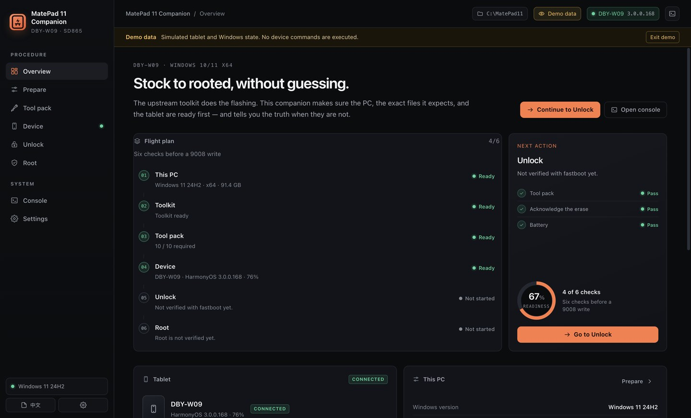

## Download

**[Latest public release](https://github.com/pallefar/matepad-11-companion/releases/latest)** — portable Windows 10/11 x64 app ZIP. The executable is unsigned, so SmartScreen may ask for **More info → Run anyway**.

The public release contains the **app only**. It does not contain the proprietary Huawei/Qualcomm files or the preloaded workspace ZIP. Use **Tool pack → Fetch external pack** (pinned sources and SHA-256) or import your own legally obtained pack.

**On a Mac?** The guide, downloads and checks run on macOS. The WinUI build, Windows drivers and EDL write still require Windows. Read [docs/MACOS.md](docs/MACOS.md) before planning a Mac-only attempt.

## Why this exists

The upstream project is source-only. There is no release, no bundled tool pack, and it is a .NET 8 / WinUI 3 build. Its own home screen checks only three files (`adb.exe`, `fastboot.exe`, `7z.exe`) — the unlock images, Qualcomm EDL tools, drivers, APatch tools and ramdisk images are discovered much later, mid-procedure.

This companion adds the missing layer:

- **Prepare** — detect Windows/.NET, download the GPL source, install .NET 8 per-user if needed, run `dotnet publish`, launch the result.
- **Provision** — inventory all 27 expected paths, auto-download open tools, **fetch the four signed/Qualcomm files in one step with pinned SHA-256**, or import the original pack. The local build can also produce a ready-made workspace ZIP with the APatch set in the exact layout; that proprietary bundle is not part of the public release.
- **Read the device** — model, HarmonyOS version, API, battery, storage, USB authorization, bootloader state, root check, 9008/EDL COM presence.
- **Route** — HarmonyOS 2/3 gets the ADB → EDL path; HarmonyOS 4 gets the engineering-cable/downgrade path, never the wrong one.
- **Gate** — DBY-W09 only, battery and disk checks, data-wipe acknowledgement, tool-pack completeness, typed `WIPE` confirmation.
- **Guide** — step ledgers with expected outputs and troubleshooting, for both the ADB and engineering-cable branches, APatch and Magisk root.
- **Record** — persistent progress, live console, diagnostics export with the serial masked.
- **Dark or light** — a persisted theme toggle in the top bar and **Settings → Appearance**. Both themes are screenshot-verified.
- **Step by step** — a guided setup with one current step, the exact action, the success condition, an expandable “What you should see / Common fixes” panel, and support buttons for diagnostics, issue reporting and documentation.
- **Hard backup gate** — choose the folder containing your 9008 images and GPT/XML; the app scans it, records counts/size/time, and blocks unlock until it is confirmed.
- **System check** — actually runs `adb`/`fastboot`, checks the Windows ADB and Qualcomm 9008 drivers, reads developer options / USB debugging / bootloader / root state, and lists Magisk, APatch, KernelSU and `su` on the tablet.

## What it deliberately does not do

- It does **not** implement EDL/9008 writes. Those remain in the upstream `MatePadToolbox`.
- It does **not** bundle the upstream binary or proprietary device files in the app package. The separate ready-workspace ZIP contains the unlock/APatch set for your own device; that ZIP is not MIT-licensed and must not be redistributed.
- It does **not** bypass Huawei ID, FRP, or any account/anti-theft control.
- It does **not** promise that unlocking or rooting is safe. A wrong EDL write can hard-brick the tablet.

## Status — read this before you rely on it

| Area | State |
|---|---|
| UI and logic | **Verified on macOS**: 46 unit tests, 34 Playwright checks against the real Electron app, EN + 中文, 1440/1120 widths, zero renderer errors |
| Official downloads | **Verified live**: platform-tools, 7-Zip, KernelPatch (kptools + kpimg), Magisk release, safe ZIP extraction |
| External pack fetch | **Verified live**: signed firehose + ABL (hashes match the independent guide), QSaharaServer, fh_loader 23.06, signed Xiaomi driver installer; all five entries hash-checked |
| Ready workspace | **Verified**: 25 files, APatch 10/10, driver entries present, manifest/checksums match; app reads it as ready |
| Windows package | **Built** (`win32-x64`, unsigned) and inspected, but **not executed** — the agent had no Windows host |
| .NET install + upstream WinUI build | **Not executed** (Windows-only XAML compiler); the command, logging and failure paths are implemented |
| Real tablet, EDL write, unlock, root | **Not tested** — no DBY-W09, no proprietary tool pack, no Windows host here |

The app is honest about this in **Settings → About** and in the diagnostics bundle. Treat the Windows-only steps as a runbook that still needs a first real run on your PC.

## The proprietary layer

The upstream repo intentionally omits the signed unlock images, the Qualcomm EDL tools, drivers, and ROM helpers. The companion can now assemble the critical unlock/APatch set for you:

- **Fetch external pack** pulls and verifies:
  - signed firehose `Huawei865870_devprg.elf` (697,648 B) and unlocked ABL `Huawei865870_abl_unlock.img` (602,112 B) from the [independent DBY-W09 guide](https://github.com/serkanvela/matepad11-hos42-root-gms)'s public Drive folder — published SHA-256 matches;
  - `QSaharaServer.exe` (174,592 B) from a MiFlash mirror;
  - `fh_loader.exe` (485,888 B, Qualcomm 23.06 build) that advertises `--skip_configure`, `--configure`, `--sendxml`, and raw reads;
  - an Authenticode-signed Xiaomi combined ADB/Qualcomm driver installer, copied to the two driver slots as a documented substitute for the author's separate installers.
- **Or import the original tool pack** (preferred when you have it) by ZIP/folder. The app never downloads from random mirrors beyond the pinned sources above.
- **Or start from the ready workspace ZIP** — every APatch file is already at the exact path; you only build the toolkit.

The **optional** leftovers are not needed to unlock or root, and cannot be sourced generically:

`tools/rawprogram/*`, `tools/ptool.exe`, `vbmeta/vbmeta.zip`, `misc.img` (ROM flashing/rescue) and `tools/HiSuiteProxy/*` (HarmonyOS 4 downgrade). Add them from the original pack or matching firmware if you plan those operations.

See **[docs/TOOL-PACK.md](docs/TOOL-PACK.md)** for full provenance, hashes and caveats. The third-party binaries remain proprietary and are not covered by this app's MIT license.

## Quick start on the Windows PC

1. Download **`MatePad-11-Companion-1.4.0-win-x64.zip`** from the [latest release](https://github.com/pallefar/matepad-11-companion/releases/latest), or use the ZIP built in this workspace. Copy the app ZIP to the Windows 10/11 x64 PC.
2. Unzip the app anywhere writable (not `Program Files`). Run **`MatePad 11 Companion.exe`**. It is unsigned, so SmartScreen may show “Windows protected your PC” → **More info → Run anyway**.
3. Choose the workspace:
   - **Public release / fresh workspace:** keep the default folder. Open **Tool pack**, press **Fetch external pack**, and download the open tools (platform-tools, 7-Zip, KernelPatch, Magisk, APatch). Or import the original pack if you already have it.
   - **Local preloaded workspace:** if you have the separate `MatePad-11-Workspace-1.0.0.zip`, unzip it and select its `MatePad11` folder in **Prepare → Change folder**. That bundle is not in the public release because it contains proprietary third-party files; the build writes `MatePadToolbox.exe` into it.
4. New here? Open **Step by step** in the sidebar; it always highlights the next action and includes **Need help?** diagnostics and issue links.
5. **Prepare → Download & build**. The app installs .NET 8 locally if needed, fetches the GPL source, runs `dotnet publish`, and shows the full log.
6. **Device** → enable USB debugging, connect a data cable, accept the RSA prompt, press **Detect tablet**. Confirm DBY-W09 and the HarmonyOS branch.
7. **Unlock** → read the preflight, type `WIPE`, confirm the backup, then **Open toolkit → Unlock BL** and follow the branch-specific steps. Verify with **Check bootloader** (`fastboot getvar unlocked` → `yes`).
8. **Root** → choose APatch (automated boot patch via 9008) or Magisk (patched ramdisk you provide), follow the steps, then **Verify root** (`adb shell su -c id` → `uid=0(root)`).

Full runbook: **[docs/WINDOWS-RUNBOOK.md](docs/WINDOWS-RUNBOOK.md)**

## HarmonyOS routing

| Detected version | Unlock route | Notes |
|---|---|---|
| HarmonyOS 2.x / 3.x | ADB → EDL | Toolkit runs `adb reboot edl`, uploads the firehose, writes the unlock ABL, resets. Some global 3.x builds ignore the reboot; the app says to stop, not retry blindly. |
| HarmonyOS 4.x | Engineering cable / test-point short, or downgrade | ADB cannot enter EDL; the app closes the step list and links the independent HOS 4.2 write-up. |
| Unknown | No route | The app refuses to guess; connect the tablet or check Settings → About tablet. |

## Root methods

| Method | What the toolkit does | What you provide |
|---|---|---|
| **APatch** (recommended default) | 9008 extracts `boot`, `kptools` unpacks/patches/repacks with `kpimg-android`, fastboot flashes the patched boot | KernelPatch `kptools.exe` + `kpimg-android` (official download), APatch APK, 9008 access |
| **Magisk** | Fastboot flashes a pre-patched `ramdisk` image | The exact matching stock ramdisk, patched by Magisk on the tablet, copied into `ramdisk/` |

Both require an unlocked bootloader. Both have a switch-method control; prerequisites update immediately.

## Screens

| | |
|---|---|
| 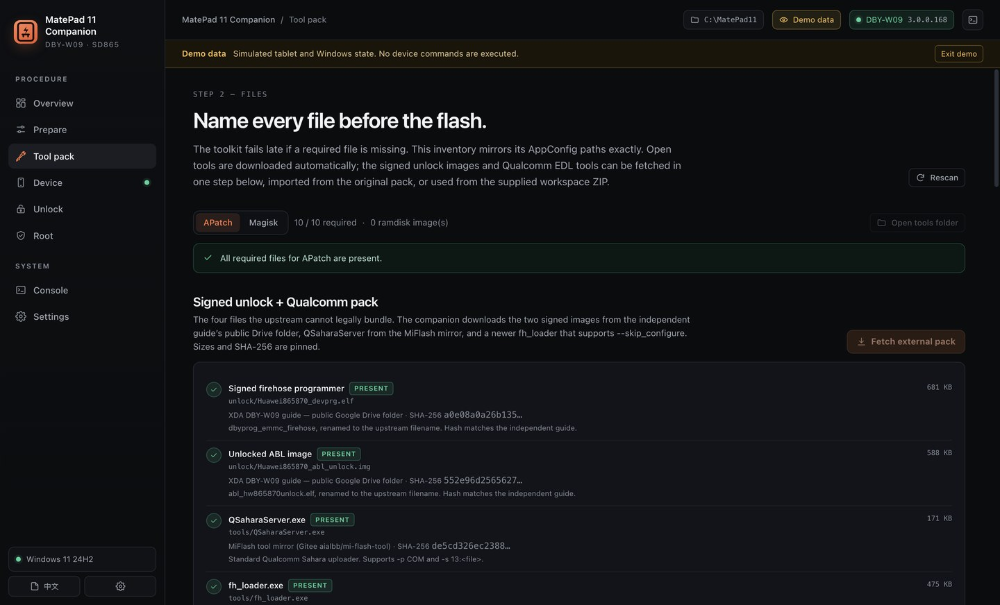 | 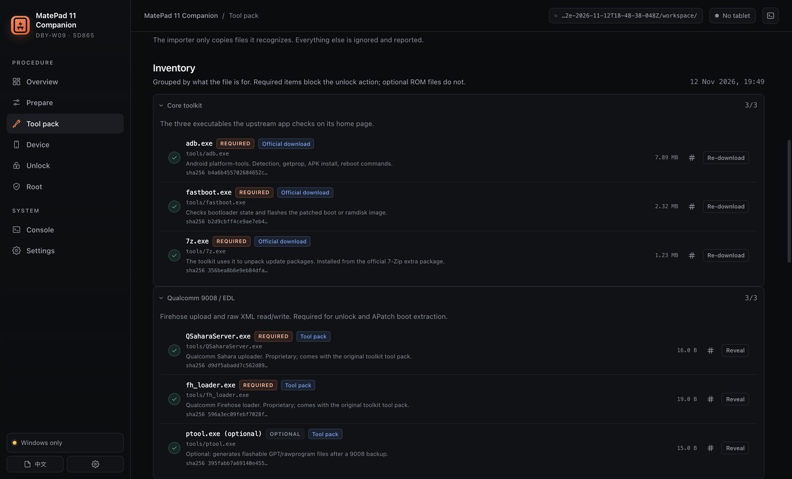 |
| 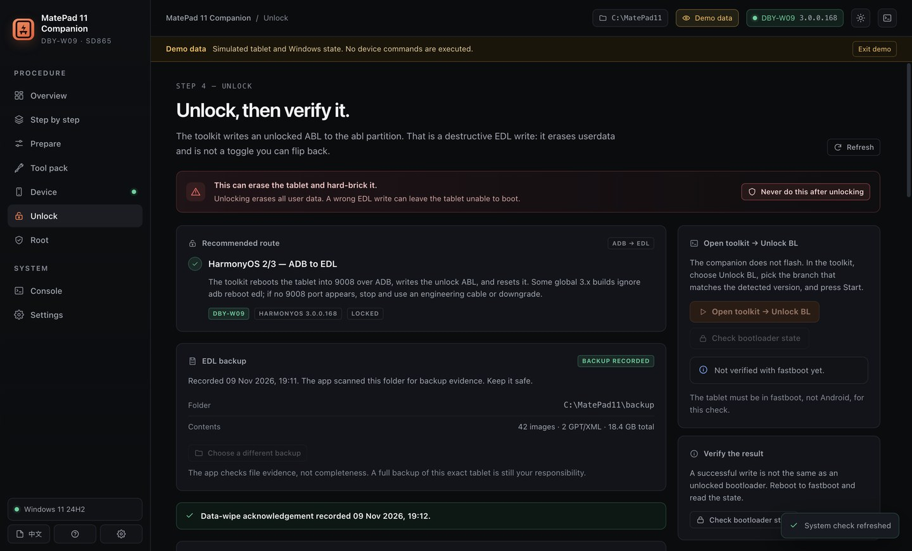 | 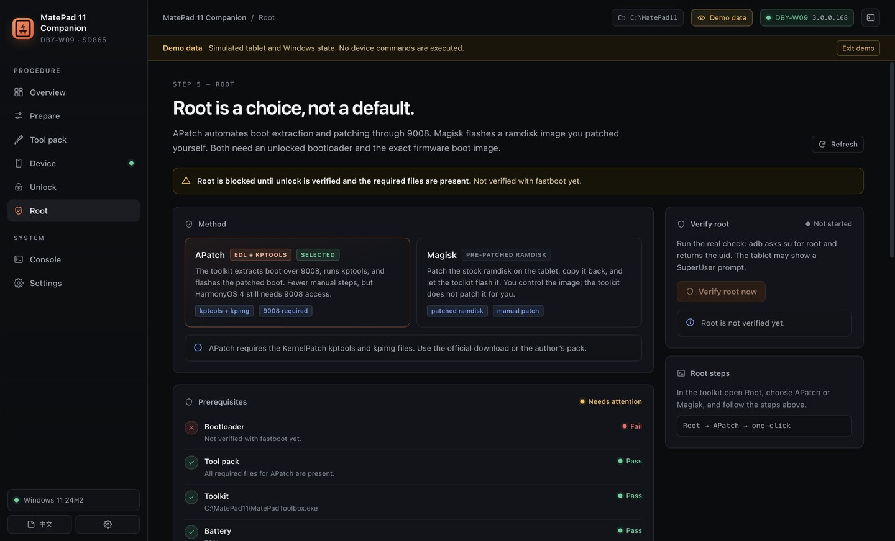 |
| 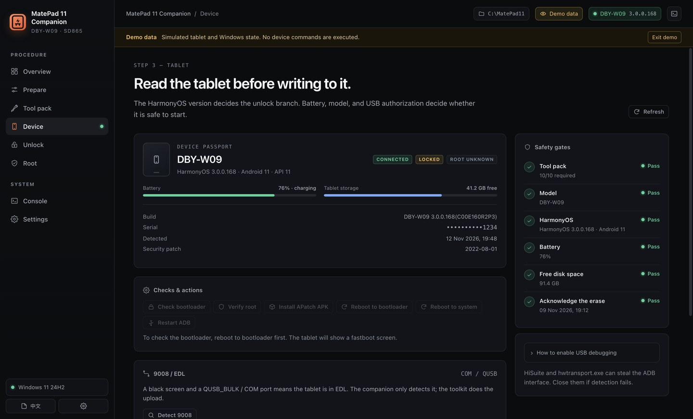 | 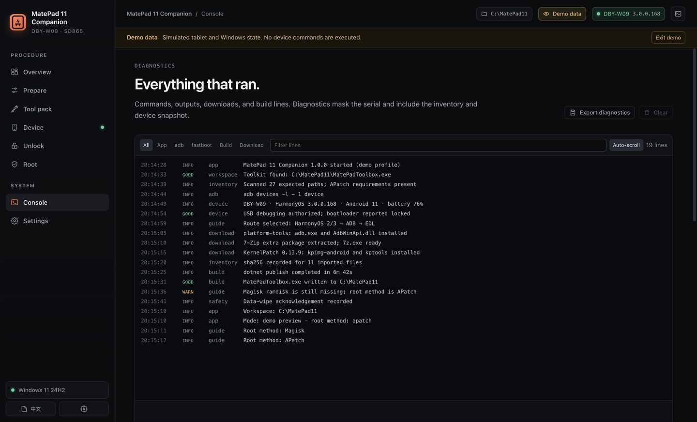 |
| 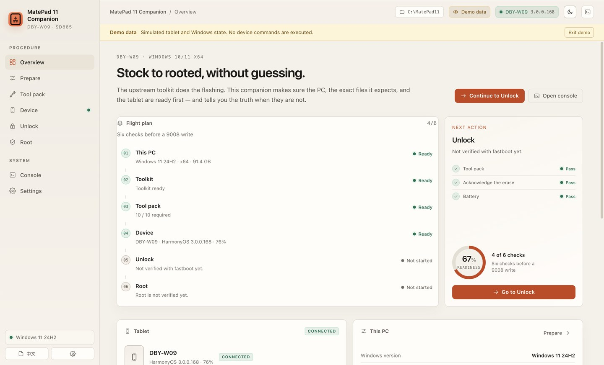 | 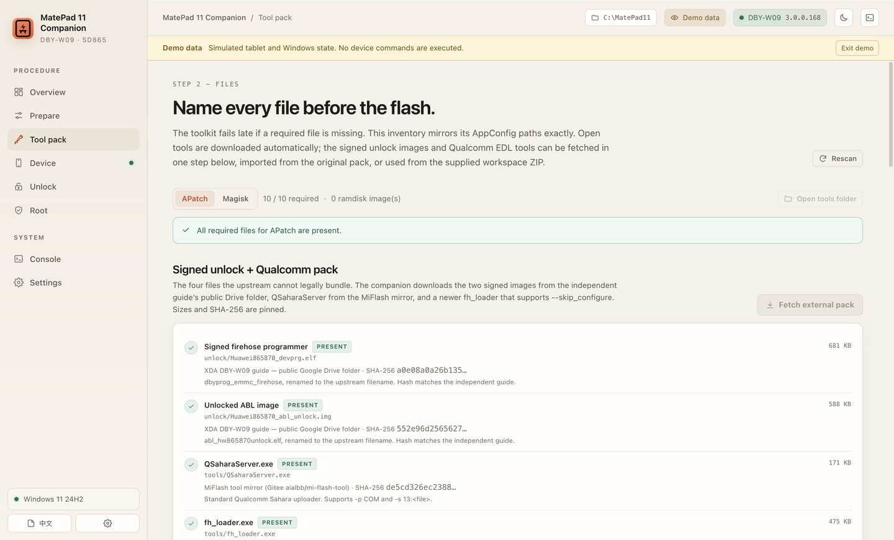 |
| 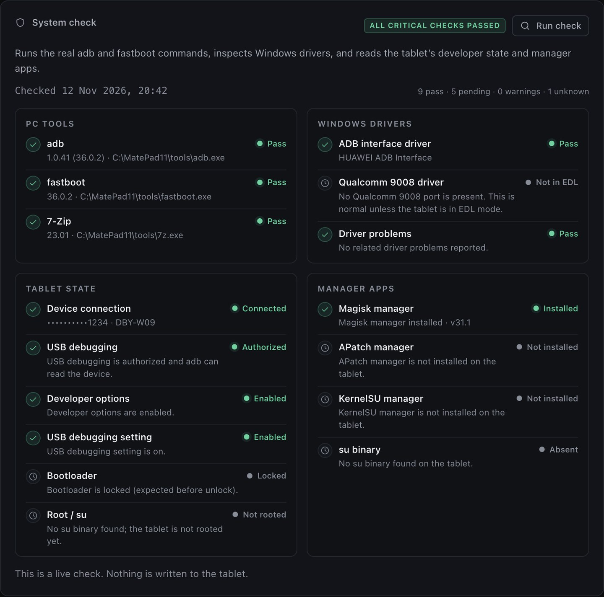 | 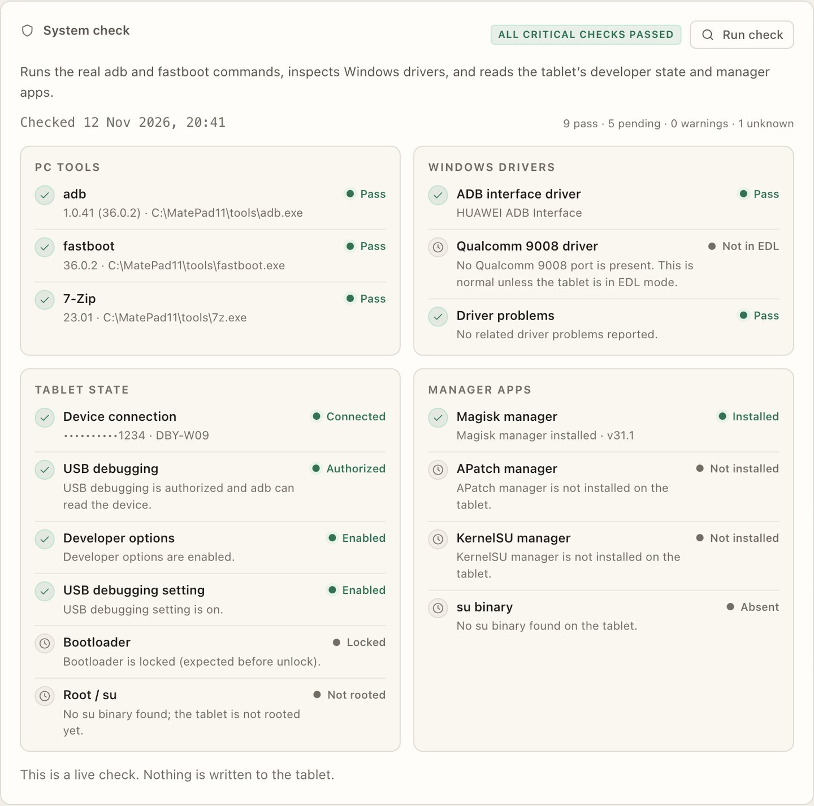 |
| 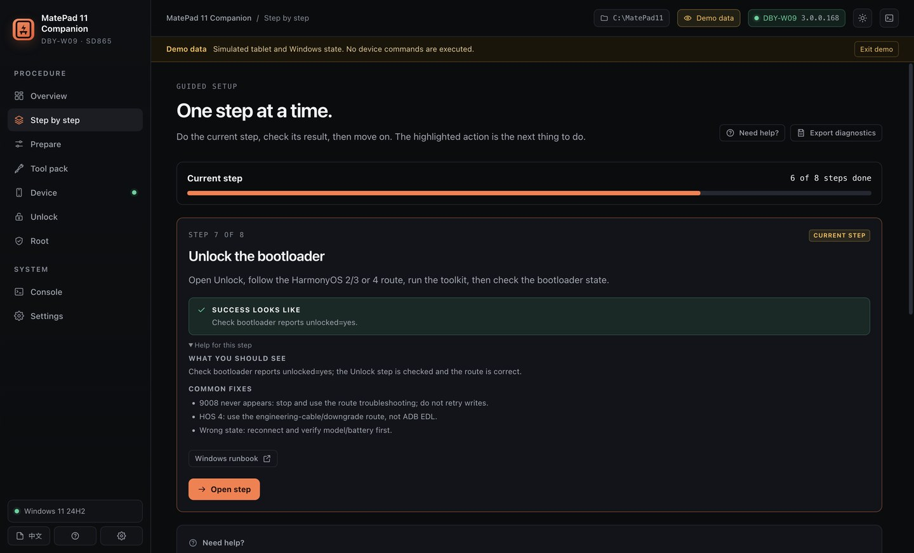 | 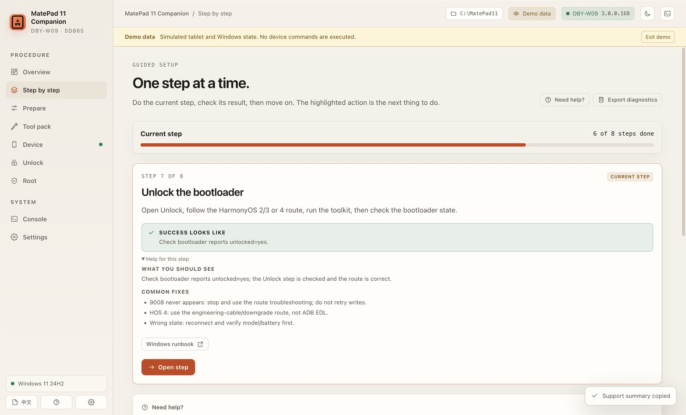 |
| 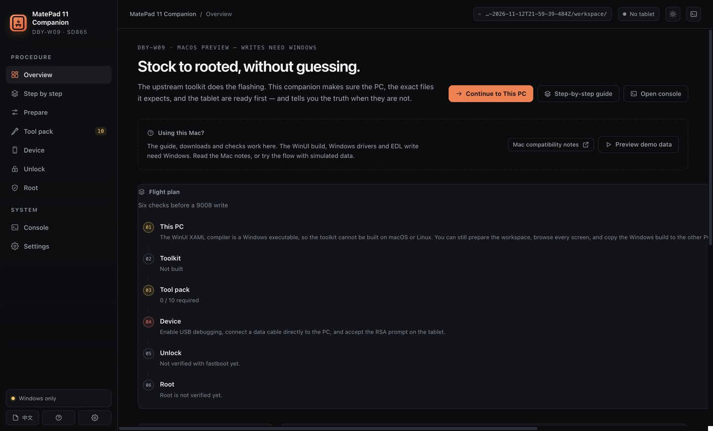 |  |
|  |  |

## Safety

- **Unlocking erases all user data.** Take an EDL backup first. The independent guide measured ~13 GB and 73 partitions for a full read-back.
- **Never flash the stock ABL after unlocking.** It relocks the bootloader; on HarmonyOS 4 you may not get back into EDL.
- **Never relock while a patched boot/ramdisk is installed.**
- **Never accept an OTA or HiSuite update after unlocking.**
- Battery above 60%, a data cable directly into the PC, no hub, no sleep during a write.
- The companion runs only read-only device commands, plus reboot/APK-install actions you explicitly press. Every flash is performed by the upstream toolkit.

## Artifacts

| File | Contents |
|---|---|
| `dist/MatePad-11-Companion-1.4.0-win-x64.zip` | Unsigned portable Windows app, docs, licenses. No proprietary device binaries. |
| `dist/MatePad-11-Workspace-1.0.0.zip` | Preloaded `MatePad11` workspace: platform-tools, 7-Zip, Magisk, APatch, KernelPatch, QSaharaServer, fh_loader 23.06, the two signed unlock images, driver installer, manifest and checksums. For personal use; not MIT. |

SHA-256 values are in `dist/CHECKSUMS.txt` and the adjacent `.sha256` files.

## Development

```bash
cd app
npm install
npm start            # real state (macOS/Linux preview; Windows for the full path)
npm run demo         # simulated DBY-W09, no device commands
npm test             # 44 node:test checks
node scripts/e2e.mjs # 34 Playwright checks against the real Electron app
npm run pack:win     # win32-x64 folder in ../dist
```

Architecture: Electron main process (`app/src/main/*`) owns filesystem/process/device work; a pure core (`app/src/core/*`) owns parsers, inventory and gates; the renderer (`app/src/renderer/*`) is vanilla HTML/CSS/JS with a context-isolated preload. No network server, no telemetry. State lives in Electron `userData`; demo mode is an in-memory overlay and never writes over real settings.

The upstream source is GPL-3.0-or-later and is downloaded at runtime; see [THIRD-PARTY.md](THIRD-PARTY.md). This companion is MIT-licensed (see [COMPANION-LICENSE.txt](COMPANION-LICENSE.txt)). Not affiliated with Huawei, Qualcomm, or the upstream author.

## Verification

See **[docs/VERIFICATION.md](docs/VERIFICATION.md)** for exactly what was run, what passed, and what remains unverified.
